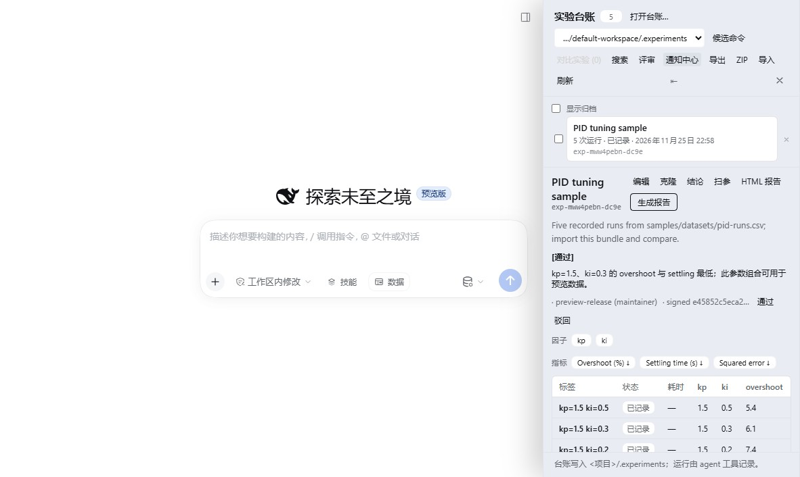
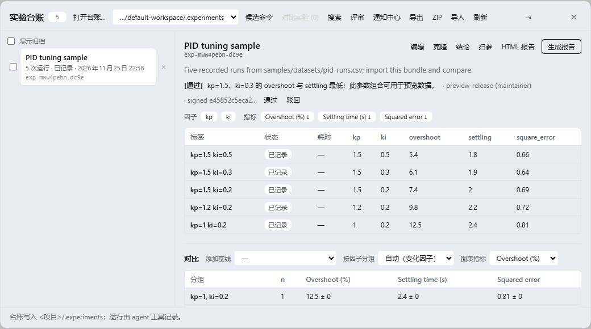
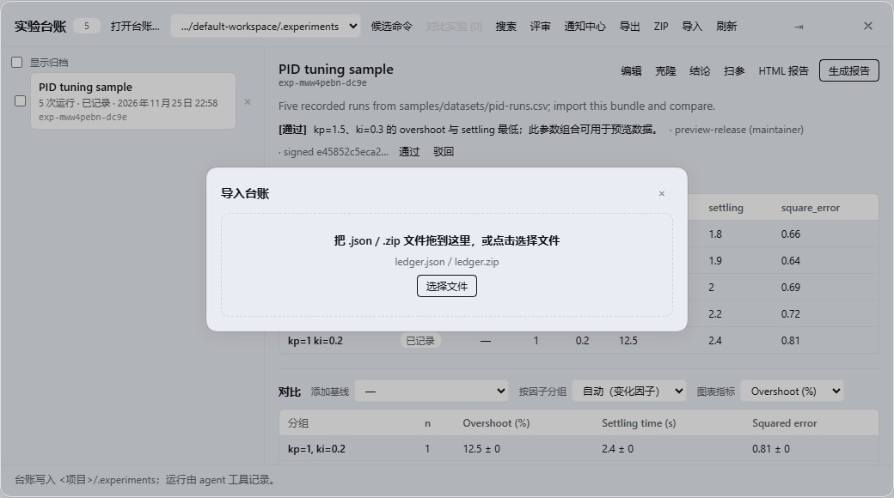
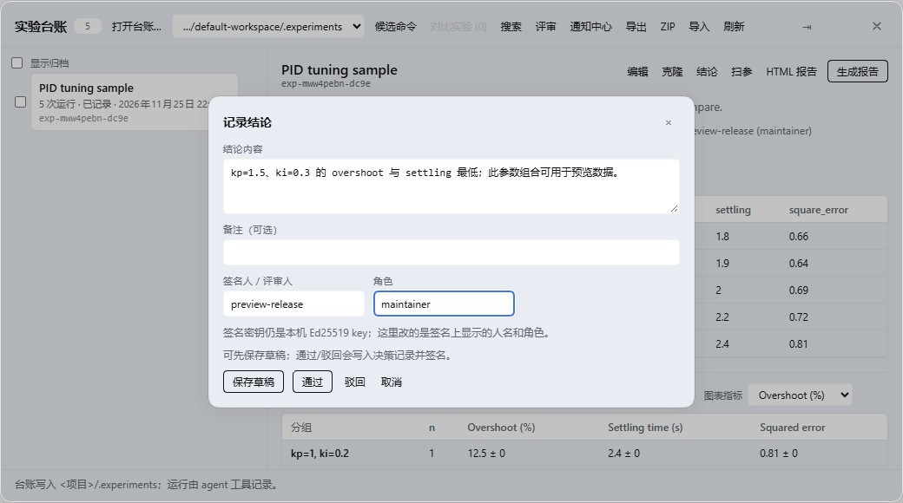

# dsh-experiment-ledger

[](https://www.npmjs.com/package/dsh-experiment-ledger)
[](LICENSE)
[](https://github.com/yasaxiwind/dsh-experiment-ledger/actions/workflows/ci.yml)

**Preview 0.35.0-preview.1** · DeepSeek Harness `>= 0.2.2-rc.5`

Local-first experiment ledger for DeepSeek Harness: **every run keeps its parameters, metrics and artifacts, and any two runs can be compared.**

The gap this fills: `dsh-science` manages a research loop, `dsh-science-workbench` manages code cells and figures — neither keeps a **structured results table**. This plugin does, and it is executor-agnostic: shell, Python, MATLAB, a CAD/MCP call or an agent run all become one run.

```
exp_define ──▶ exp_run ──▶ exp_show
                 │            │
                 └── metrics ─┴── panel: runs table + run detail
```









The screenshots use the synthetic `samples/` data. The DSH sidebar, session list, workspace label and user name were hidden before capture; no real conversation or personal data is shown.

## Install

### From npm (preview tag)

```sh
dsh plugin --profile <profile> add dsh-experiment-ledger@preview
```

Published on npm as `0.35.0-preview.1` (the `preview` tag).

In **DSH Desktop**: **Settings → Plugins → + Add plugin**, enter `dsh-experiment-ledger@preview`, install, enable the bundle, then reload the page.

### From a tarball

```sh
dsh plugin --profile <profile> add ./dsh-experiment-ledger-0.35.0-preview.1.tgz
```

### From this folder (development)

From the workspace (local development):

1. Open **Settings → Plugins → + Add plugin**.
2. Pick the folder `dsh-experiment-ledger` (or paste its absolute path).
3. **Install** and enable it; reload the page for the panel.

Requires DeepSeek Harness `>= 0.2.2-rc.5`. No dependencies, no network, no telemetry. Full install, state locations, sharing, limits and troubleshooting: [docs/INSTALL.md](docs/INSTALL.md). Ready-to-use CSV/TSV/scripts/bundles: [samples/README.md](samples/README.md).

## Panel

The footer action opens a floating panel; the header's **⇥/⇤** button docks it to the right sidebar (the choice is remembered). Docking **shrinks the session column** by the panel width instead of covering it, and the panel starts below the DSH title bar. **打开台账…** browses folders and accepts a project folder (its `.experiments` is found) or a ledger folder; **在这里新建台账** creates one. **导入** opens a drag-and-drop/file picker for `.json`/`.zip` bundles — no path typing. **结论** opens an in-panel editor for draft/approve/reject with editable **signer name + role** (persisted; the cryptographic key remains the local Ed25519 profile key). The left list's **×** removes an experiment from the ledger after inline confirmation, keeping run files and datasets. The agent can call `exp_open` to open the sidebar directly on a ledger/experiment.

## Tools

| Tool | What it does |
|---|---|
| `exp_define` | Create/update an experiment: name, description, factors, metrics (unit + direction, optional SQL over a `dataset` path or `datasetId`). |
| `exp_conclude` | Record a conclusion and decision status (draft/approved/rejected), with reviewer/role and a bounded history. |
| `exp_reviews` | List the review queue filtered by conclusion status and reviewer/role. |
| `exp_review` | Batch approve/reject up to 20 experiment conclusions. |
| `exp_dataset` | Register a CSV/TSV under a stable `ds-…` id (or list the registry); `dataConsole=true` imports the files open/recent in the DSH data console. |
| `exp_export` | Export the ledger (or one experiment) to a portable JSON bundle or signed zip package (bundle + logs + reports + datasets). |
| `exp_import` | Merge a JSON bundle or zip package by experiment/run id and SHA-256; `prefer="incoming"`, `dryRun=true`, `requireTrusted=true`. |
| `exp_trust_key` | List, add, rotate, revoke or remove trusted package-signing keys (local key, a package's embedded key, or a PEM public key). |
| `exp_open` | Open the ledger panel in the DSH sidebar, optionally selecting a ledger folder and experiment. |
| `exp_anchor` | Anchor the audit head in an external file, a git commit, or an HTTP endpoint. |
| `exp_verify_anchor` | Read an external anchor back and verify its head/count against the local chain and anchor registry. |
| `exp_audit` | Show and verify the append-only hash-chained audit log plus external anchors. |
| `exp_clone` | Clone an experiment as a template: factors, metrics, description and tags, without runs. |
| `exp_batch` | Run one command template over explicit parameter rows (up to 50) and record each run. |
| `exp_run` | Run one shell command as a run: `{param}` substitution, stdout/stderr capture, exit/duration, metrics, artifact hashes. |
| `exp_record` | Record a run that already happened (bench work, external instrument, manual trial). |
| `exp_compare` | Group runs by factor values, summarize each metric (mean, sd, 95% CI, min, max), list the best run and optionally compare two groups (Welch p, Cohen d, CI of the difference). |
| `exp_diff` | Compare a run with another (default: the previous run): changed parameters, metrics and artifacts. |
| `exp_baseline` | Add, replace or clear named baselines (up to five): each snapshots one run of another experiment, and comparisons/reports show deltas. |
| `exp_sweep` | Expand a grid (or explicit rows) into many runs of one command, with bounded concurrency, `failFast`, `dryRun` and per-run records. |
| `exp_presets` | List, save or delete sweep presets (command template, grid, parallelism); `exp_sweep` can run one by `preset` name. |
| `exp_schedule` | List, save, delete, toggle or run scheduled sweeps: a saved preset every N minutes while the app is open. |
| `exp_candidates` | List commands recorded passively from tool calls; no output or environment is stored. |
| `exp_promote` | Turn a candidate into a run without executing it again, attaching parameters, metrics, artifacts and datasets. |
| `exp_report` | Write a Markdown, self-contained HTML, or print-optimised report (design, datasets, runs, comparison with CI, charts, best runs, artifacts) and return its path and SHA-256. |
| `exp_report_compare` | Write a standalone 2–4 experiment comparison report (optionally across ledger roots): one table per metric, grouped by shared factors; `format="html"` makes it a single portable file. |
| `exp_list` | List experiments with run counts and last status; archived ones are hidden unless `includeArchived`. |
| `exp_show` | Show an experiment's run table, or one run in detail (params, metrics, datasets, artifacts, logs, manifest). |
| `exp_search` | Search runs across experiments by text, parameter/metric conditions, status and date; sort by a metric. |
| `exp_reproduce` | Rerun a recorded run with its command and params (`confirm=true`), recording `reproducedFrom`. |
| `exp_update` | Rename an experiment, change its description, set tags or archive it. |
| `exp_update_run` | Change a run's label or notes. |
| `exp_delete_run` | Delete one run record (`confirm=true`; the run directory on disk is kept). |

### Sweeps

`exp_sweep` expands `grid: {factor: [values]}` (cartesian) or `rows: [{...}]` into runs of one command template. It runs sequentially by default, supports `maxParallel` (cap 4), `maxRuns` (default 50, cap 100), `failFast` (stop after a non-ok run) and `dryRun` to preview. Every run is appended as it finishes, so an interrupted sweep keeps what already ran. The panel's **Sweep** form starts the same job through `POST /sweep` and polls progress; at most three sweeps run at once.

Save a form as a preset with `exp_presets action="save" name="quick" command="…" grid={…}` (up to 10 per experiment, same name replaces). `exp_sweep experimentId="…" preset="quick"` runs it; the panel's preset row loads one into the form or deletes it.

### Scheduled sweeps

`exp_schedule action="save" name="nightly" preset="quick" intervalMinutes=1440 retryLimit=2 retryDelayMs=60000 failureLimit=3` runs the preset every N minutes (1–10080) **while the desktop app is open**. The host checks due schedules every 30 seconds across remembered roots, starts the sweep as a background job and records `lastRunAt`, `nextRunAt`, `lastStatus` and `lastJobId` on the schedule. A failed run (non-zero exit or execution error) is retried up to `retryLimit` times (0–5) with exponential backoff from `retryDelayMs` (10 s–1 h); success resets the retry counter. With `failureLimit` (0–10) the schedule **pauses itself** after that many consecutive failures and raises a notification, so a broken job cannot retry forever. `run` starts it immediately; `toggle` pauses/resumes; `delete` removes it. Up to 10 schedules per experiment. The panel's Sweep form has a schedule row (name, preset, interval, retries, backoff, failure limit, add) and per-schedule run/pause/delete buttons.

Each finished scheduled job is appended to the schedule's `history` (last 20: status, attempt, done/total, failed, duration and mean metrics). The panel draws a duration sparkline plus a metrics sparkline and shows success rate and average duration. Clicking a schedule name opens a **schedule detail** view: a larger chart (duration or any metric from the history), a metric selector, run/pause actions and the full history table.

**Generate report** in the detail view writes `<ledger>/reports/schedule-<name>-<stamp>/report.md` (summary, history table, embedded duration chart) and archives the record (last 20 per experiment); past reports are listed in the detail view with an Open action.

### Notifications

When a scheduled sweep finishes, fails, or fails to start, the host appends a notification to the ledger (`notifications`, last 50). The panel polls `GET /notifications` every 20 seconds while open and shows the newest unread message in a banner; **View** opens the experiment and its Sweep form (marking that notification read), **Mark all read** posts `/notifications/read`.

A pause notification carries `action: "resume-run"`: the banner and the notification center show **Resume and run**, which posts `/schedule` with `action="resume-run"` — re-enabling the schedule, resetting its failure/retry counters and starting it immediately.

The header's **Notifications** button opens the notification center: `GET /notifications/all` aggregates unread and read items from every remembered root (last 100), grouped by project. Filter by project, level or unread; **Mark all read** and **Resume all** act on the filtered set, and each item has View, Resume and Mark read.

### Recorder

The plugin observes `tools/pre-execute` and `tools/result` and keeps the last 50 commands that had a `command` argument (bash, pwsh, MCP tools). A candidate stores only tool name, command, cwd, status and duration — no output, no environment. Promote one with `exp_promote`, or from the panel's **Candidates** view with the promote form. Disable capture with a row config:

```yaml
- id: experiment-ledger
  name: dsh-experiment-ledger
  config:
    recorder: false
```

### Compare, diff & report

`exp_compare` groups by the factors that actually vary; pass `groupBy: []` to compare all runs together, or name specific factors. `exp_diff` answers "what changed in this run versus the previous one". `exp_report` writes `reports/<stamp>-<slug>/report.md` plus one `charts/<metric>.svg` per numeric metric, and records the digest on the experiment.

### Datasets

Pass `datasets` to `exp_run` / `exp_record` to record the input files a run consumed: each gets a SHA-256, size, kind and, for CSV/TSV, an approximate rows × columns count. Statistics stay with the agent and the data console — a typical loop is `data_query` for the metric, then `exp_run` with both `metrics` and `datasets`.

### Search and reproducibility

`exp_search query="adam" metricFilters=[{key:"overshoot", op:"lt", value:5}]` searches every run in a ledger (optionally one experiment) by text over experiment/run/command/notes/params/metrics, parameter and metric conditions (`eq`, `ne`, `gt`, `gte`, `lt`, `lte`, `contains`), status and `since` date. It returns the newest matches or ranks by `sortMetric` (`direction: min|max`), up to 50. The panel's **Search** view uses the same route (`GET /search`) with text + status.

Every `exp_run`/`exp_record` stores a manifest: the substituted command, cwd, `git` commit/branch/dirty (when inside a repository), toolchain (node/platform/arch) and an allow-listed environment (`EXP_*`, `CUDA_VISIBLE_DEVICES`, `OMP_NUM_THREADS`, `PYTHONHASHSEED`, `NODE_OPTIONS`). `exp_show` and the panel's run detail display it.

`exp_reproduce experimentId runId confirm=true` reruns the **exact recorded command** for runs with a manifest (no placeholder substitution again) with the same params, cwd and recorded timeout, and re-applies the allow-listed manifest environment; legacy runs without a manifest get their stored command template substituted with the recorded params. It records a new run with `reproducedFrom`. Without `confirm` it prints the command, cwd, timeout, env keys and a preflight warning if the referenced script file is missing. If the original cwd is gone it refuses with a clear error; if the rerun fails, the returned text includes the exit code and stderr tail. The panel's **Reproduce** button does the same after a confirmation prompt showing the command (disabled for runs recorded without a command).

### Statistics

Every group summary carries `mean ± sd`, a 95% confidence interval and an `n < 3` warning (the interval is unreliable with one or two values). `exp_compare compareGroups=["k=1","k=2"]` adds a pairwise section per metric: difference, 95% CI of the difference, Cohen's d (with a negligible/small/medium/large label) and the two-sided Welch p-value. The panel shows the interval and the small-sample warning in its compare table; reports add the interval and a warning line.

### Lifecycle

`exp_update` renames an experiment, changes its description, replaces tags (up to 20, 40 chars each) or archives/restores it. Archived experiments are hidden from `exp_list` and `exp_search` unless `includeArchived=true`; the panel hides them behind a **Show archived** checkbox and shows a badge.

`exp_update_run` changes a run's label or notes; `exp_delete_run confirm=true` removes the run record (the run directory on disk is kept). The panel's run detail has a notes box and a delete button.

### HTML reports and sharing

`exp_report format="html"` writes `reports/<stamp>-<slug>/report.html`: one self-contained file with inline CSS and SVG charts, no external assets, so it can be opened, zipped or sent as-is. It contains the description, summary cards, comparison table with 95% CIs and the n<3 warning, charts, runs and datasets. `exp_report_compare format="html"` does the same for a 2–4 experiment comparison. The panel's **HTML report** and **HTML** compare buttons call the same routes.

### Anchoring and print

`exp_anchor mode="file" path="…"` writes the current audit head/count to an external JSON file; `mode="git"` commits `audit-anchor.json` in a repository; `mode="http" url="…"` POSTs the anchor. Local anchor records are kept under `$DSH_HOME/experiment-ledger/anchors.ndjson`, and `exp_audit` verifies each anchor against the chain (`N/M anchors valid`), so a wholesale chain rewrite is detectable.

`exp_report format="print"` writes `report-print.html` with `@media print` page rules, a two-column chart grid and no dark-mode UI; open it in a browser and Print → Save as PDF for a fixed-layout copy.

### Datasets and the data console

`exp_dataset path="data.csv"` hashes the file and registers it under a stable `ds-…` id in the ledger; `exp_dataset list=true` shows the registry. A metric can then use `{sql, datasetId}` instead of a file path, so moving the project or the dataset does not break the definition until you re-register it. `exp_dataset dataConsole=true` imports the files currently open/recent in the DSH data console (`<DSH_HOME>/data-console/datasets.json`); those paths are hashed and registered with `source: "data-console"`.

```jsonc
{ "key": "mean_y", "sql": "SELECT avg(y) AS value FROM data", "datasetId": "ds-2a2b86e74f" }
```

SQL metrics still accept a `dataset` path for quick one-off definitions. A `dataConsole` name (file name/path) is resolved **at run time** against the data console's open/recent state, so it follows the current file:

```jsonc
{ "key": "mean_y", "sql": "SELECT avg(y) AS value FROM data", "dataConsole": "measurements.csv" }
```

### Conclusions and decisions

`exp_conclude experimentId text="Kp=1.8 wins" status="approved" decidedBy="lead" role="maintainer"` stores the conclusion, a decision status (`draft`/`approved`/`rejected`), reviewer/role, optional `note`, and a bounded history (50 entries). Approved/rejected decisions are **signed with the local Ed25519 key**; `exp_show` prints the decision signature and reports/packages include reviewer and role. `exp_reviews` lists the queue (`status=draft` by default, optional `reviewer` filter); `exp_review experimentIds=[…] status="approved"` batch-approves up to 20. The panel's **Reviews** view lists draft conclusions with per-row Approve/Reject and **Approve all**.

### Sharing and moving ledgers

`exp_export path="ledger.json"` writes a `dsh-experiment-ledger-bundle` (version 1): experiments, runs, the dataset registry, comparison reports and the audit **anchor** (`headHash`, `count`), plus counts and a source root. `format="zip"` instead writes a `dsh-experiment-ledger-package` zip containing `ledger.json`, `manifest.json` (bundle SHA-256, counts, compression, Ed25519 signature over `bundleSha256 + auditHead`, audit anchor), `summary.md` (per-experiment conclusions), `audit.ndjson` (the sender's hash-chained audit log mirror), `runs/<id>/*.log` (≤5 MB each), the report/chart files and the registered/run dataset files (≤30 MB each). Entries are deflated when smaller; import verifies `ledger.json` against `manifest.bundleSha256`, the Ed25519 signature, and the mirrored audit chain/head before merging. **Trusted keys** are pinned in `$DSH_HOME/experiment-ledger/trusted-keys.json`: `exp_export` pins the local key; `exp_trust_key path="package.zip"` pins a received key; `exp_import requireTrusted=true` rejects unsigned/untrusted packages. Keys support `expiresInDays`, `revoke=<keyId>` and `rotate=true` (old key is revoked but signatures made before revocation still count). Every decision/import/export/key change is appended to a hash-chained audit log (`exp_audit` verifies the chain). `exp_import path="ledger.zip"` extracts packed datasets under the destination ledger and rewrites dataset ids/paths, then merges like a JSON bundle:

- experiments merge by **id**; new experiments keep their id and get ` (imported)` if the name is taken;
- runs merge by **id** (local wins by default, `prefer="incoming"` replaces duplicates);
- datasets merge by **SHA-256**, comparison reports by **digest**;
- `dryRun=true` reports the counts without writing.

The panel's **Export** button writes `<root>/exports/ledger-<stamp>.json` and the **ZIP** button writes the package; **Import** accepts either path and reloads the list. Bundles are plain JSON and can be committed or zipped; absolute run/dataset paths inside them are kept as-is.

### Templates and batch runs

`exp_clone experimentId` copies factors, metrics, description and tags into a new experiment with no runs, so a new round does not start from a blank definition. `exp_batch experimentId command="…" rows=[{"lr":0.1},{"lr":0.2}]` runs the template sequentially and records each run (up to 50 rows, optional `stopOnError`, per-run timeout). The panel's **Clone** button clones the selected experiment.

Add up to five named baselines from runs in the same ledger:

```jsonc
{ "experimentId": "exp-new", "baselineExperimentId": "exp-old", "baselineRunId": "run-…", "name": "v1" }
```

`exp_baseline` snapshots that run's metrics and params into the experiment, so the ledger does not need the other experiment to render a report. Without `baselineRunId` it takes the latest run with metrics; a same-named baseline is replaced. Remove one with `clear: true` plus `baselineId` or `name`, or all with `clear: true` alone.

The panel's compare block has an **Add baseline** selector and one chip per baseline. The newest baseline drives the inline `(Δ …)` and the run-detail vs-baseline diff; `exp_report` adds a Baselines section and one Δ table per baseline.

### Multi-experiment comparison

Tick 2–3 experiments in the side list and press **Compare experiments**. The panel shows one metric across a grouping shared by the selected experiments: rows are groups, columns are experiments with `mean ± sd (n)`. Factors that are not declared in every experiment are hidden; with no common factor the table compares whole experiments.

The **Add experiment from another project** selector lists experiments from the other remembered ledger roots; refs are `{root, id}` pairs, so one table can mix projects. The **Generate comparison report** button writes `<ledger>/reports/compare-<stamp>/report.md` with one table per metric (up to eight) and records it in the ledger's `compareReports` archive (last 20); the view lists past reports with Open actions. `exp_report_compare` does the same from the agent.

**Export** writes the matrix under `<ledger>/exports/` as CSV (numeric `mean/sd/n` columns) or Markdown (the rendered table); the panel shows the path, a copy button and an Open action.

### Metrics conventions

A run can produce metrics in four ways, later sources winning:

1. declare a metric with `sql` + `dataset`: computed from a CSV/TSV table named `data` (lowest precedence)
2. print a line on stdout: `EXP_METRICS: {"overshoot": 4.2, "settling": 0.8}`
3. write `metrics.json` into the run directory (`$EXP_RUN_DIR`)
4. pass `metrics` to `exp_run` / `exp_record` (highest precedence)

Parameters are exposed to the command as `EXP_PARAM_<KEY>` environment variables and substituted into `{key}` placeholders.

### SQL metrics

A metric can declare its own query and dataset:

```json
"metrics": [
  { "key": "yield", "unit": "%", "direction": "max",
    "sql": "SELECT avg(pass) * 100 AS v FROM data WHERE split = 'test'",
    "dataset": "runs/bench.csv" }
]
```

At `exp_run` / `exp_record` / `exp_sweep` time the dataset is loaded into an in-memory SQLite table named `data`, the query's first row supplies the value (use `column` to pick a named column), and the dataset is attached to the run's provenance automatically. Explicit metrics, `metrics.json` and `EXP_METRICS` output override the SQL value. Query errors are recorded as `metricErrors` and reported by `exp_run` / `exp_show` instead of failing the run.

The loader handles CSV and TSV up to 50 MB / 500k rows, one statement, and needs the Node built-in `node:sqlite`. Excel and interactive exploration stay in the data console, which can export a CSV for the ledger.

## Storage

The ledger is plain JSON under `<project>/.experiments/`:

```
.experiments/
├─ ledger.json                 # experiments, runs, metrics, artifact hashes, dataset registry
├─ exports/ledger-<stamp>.json # portable bundle from exp_export
├─ reports/<stamp>-<slug>/     # report.md or report.html + charts/<metric>.svg from exp_report
└─ runs/<run-id>/
   ├─ stdout.log
   ├─ stderr.log
   └─ metrics.json             # optional, written by the command
```

An explicit `root` argument (absolute or relative to the session cwd) moves the ledger elsewhere. The panel remembers the last 20 roots. Passive candidates live outside a project, in `$DSH_HOME/experiment-ledger/candidates.json` (ring buffer of 50).

## Panel

A **实验台账 / Experiments** action in the sidebar footer opens the panel:

- experiments list on the left, run table on the right; experiments can be renamed, described, tagged and archived, with a **Show archived** filter;
- dynamic columns for declared factors and metrics;
- **HTML report** next to **Generate report**: one self-contained file; the compare view has the same HTML button for its report;
- **dataset registry**: `exp_dataset` gives SQL metrics stable `ds-…` ids and imports open/recent data-console files; a `dataConsole` metric name is re-resolved at run time;
- **conclusion**: record/approve/reject an experiment conclusion, shown in the panel and reports; **Reviews** lists drafts with Approve all;
- **Export / Import**: write a portable ledger bundle or merge one from another machine/project; **Clone** copies the selected template;
- **compare block**: group by the varying factors (default), one factor, all factors, or no grouping; table of mean ± sd with a 95% CI and an n<3 warning, a bar chart with ±sd + 95% CI whiskers, and **small multiples** for every numeric metric;
- click a run for parameters, metrics, dataset hashes, artifact hashes, a diff against the previous run, stdout/stderr tails, the reproducibility manifest, editable notes and a delete action; **Reproduce** reruns it;
- **search view**: text + status over runs, results jump to the experiment and run;
- **notifications**: unread banner, cross-project center with filters and bulk read/resume;
- **candidates view**: commands recorded passively, with a promote form (label, params, metrics) for the selected experiment;
- **sweep form**: command template + JSON grid, presets, scheduled runs with history, background job with live progress and a stop button; finished scheduled runs raise an in-panel notification;
- **report button**: generate the Markdown or self-contained HTML report from the panel, open it in the OS, or copy its path;
- **baseline chips**: add named baselines from runs of the ledger; the newest drives the inline Δ and a run's detail shows a vs-baseline diff;
- **multi-experiment comparison**: tick 2–3 experiments (or add one from another project) and compare one metric across a shared factor grouping; export CSV/Markdown or write a comparison report;
- a root selector for projects with more than one ledger.

Runs still come from the tools or the recorder; the panel only promotes those records and writes reports, so the agent and the UI see the same ledger.

## What it does not do

- No hypothesis state machine or research narrative (that is `dsh-science`).
- No code cells or figure versioning (that is `dsh-science-workbench`).
- No claim/evidence sealing or reproducibility audit (that is `dsh-research-report` / `dsh-repro-audit`), though its run records are designed to feed them later.

## Limits

- Inline output in `ledger.json` is capped (2 KB stdout, 1 KB stderr); full logs stay on disk.
- Artifacts are hashed, not copied; moving a file leaves a stale path.
- `exp_run` executes one command per call; use `exp_sweep` for a parameter grid (up to 4 concurrent).
- Comparison uses the sample standard deviation (n−1); a single run reports sd 0.
- Datasets are hashed in place; text-table row/column counts stop after 5M rows or 200 MB and set `truncated`.
- Reports list at most 100 runs by default, embed up to 8 charts, and keep the last 20 report records per experiment.
- Baselines are snapshots (up to five per experiment); later changes to the source run do not update them.
- Sweep presets are capped at 10 per experiment; exports land in `<ledger>/exports/` and are not pruned automatically.
- Multi-experiment comparison accepts 2–4 refs; the panel ticks up to 3 and lists experiments from up to 20 remembered roots.
- `exp_search` scans one ledger in memory and returns at most 50 rows; the manifest env allowlist is `EXP_*`, `CUDA_VISIBLE_DEVICES`, `OMP_NUM_THREADS`, `PYTHONHASHSEED`, `NODE_OPTIONS`.
- Scheduled sweeps only run while the desktop app is open; the scheduler checks due schedules every 30 seconds and keeps at most 10 schedules per experiment.
- Scheduled retries are capped at 5, with backoff from 10 s to 1 h; a retry attempt appears in the history and raises its own notification.
- Pairwise statistics need at least two values per group; the Welch p-value uses a small-sample t approximation, not a full statistical package.
- Archived experiments are hidden by default; deleting a run removes only the ledger record, not its output directory.
- The data-console integration imports **file paths and hashes**, not live dataset ids: the data console's `ds1` ids are per-process, so the ledger assigns its own stable `ds-…` ids. A `dataConsole` metric name is resolved from the console's open/recent list at run time; it still reads a CSV/TSV file and does not execute in the console's sidecar.
- Conclusions are local free text with a status and history; there is no identity/permission enforcement on approve/reject.
- HTML reports are static snapshots; they do not embed the ledger or follow later runs.
- Ledger bundles include absolute run/dataset paths; import them only where those files exist, or re-register datasets after moving a project. Import is a merge, not a replace; bundles are capped at 50 MB.
- Zip packages deflate entries when smaller, include report files, `summary.md` and registered/referenced dataset files (≤30 MB each), and verify `bundleSha256` + Ed25519 signature on import; `sign=false` is possible.
- The package signature is self-signed: the public key travels inside the package; `exp_trust_key` pins a key for `requireTrusted=true`, but this is not a CA/account identity. Reviewers/roles remain free text.
- Decision signatures bind an approved/rejected conclusion to a local key; losing/rotating the key does not invalidate old signatures (the public key and signing time are stored on the decision).
- The audit log is tamper-evident, not tamper-proof: a local writer can rewrite the whole chain; verification detects accidental edits/deletions. Packages carry a mirror + signed head so a recipient can detect a broken sender chain. External anchors help, but git/HTTP targets are only as trustworthy as their host.
- `format="print"` is an HTML print view, not a generated PDF; use the browser's Print → Save as PDF.
- `failureLimit` is capped at 10; hitting it pauses the schedule (a manual resume resets the counter).
- Schedule history keeps the last 20 jobs; ledger notifications keep the last 50 entries and are not pruned by the panel.
- Schedule reports are archived per experiment (last 20 records); report files themselves are not pruned.
- Comparison reports are archived in the destination ledger (last 20 records); the report files themselves are not pruned.
- Sweeps plan at most 100 runs (`maxRuns` default 50) and run at most 4 commands at once; the panel keeps up to 6 finished jobs and runs at most 3 at a time.
- The recorder keeps the last 50 candidates and never stores output, environment variables or exit codes.
- Windows kills the whole process tree on timeout; POSIX uses the process group.

## Development

```sh
node --check index.js
node --check client.js
node --test test/ledger.test.mjs test/client.smoke.test.mjs test/tools.test.mjs test/compare.test.mjs
```
